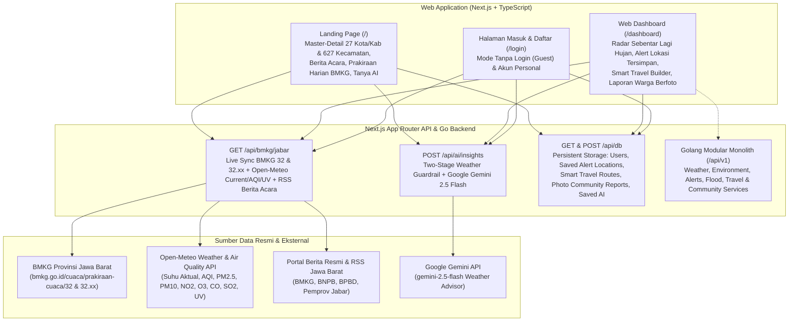
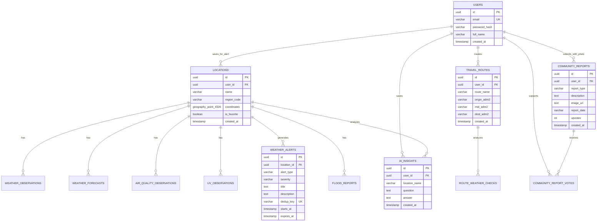

<div align="center">

# WEATHERLY
### **Know the Weather. Prepare Before It Happens.**

**Platform Intelijen Cuaca Web untuk Seluruh 27 Kota/Kabupaten & 627 Kecamatan di Jawa Barat (BMKG Kode 32), Berita Acara Cuaca & Bencana, Pemantauan Udara & UV Real-Time, Asisten Cuaca AI, Rute Perjalanan Smart Travel, serta Laporan Warga Berfoto.**

[](https://go.dev/)
[](https://nextjs.org/)
[](https://postgis.net/)
[](https://redis.io/)
[](https://www.docker.com/)

[Visi & Latar Belakang](#-kenapa-weatherly-dibuat-why-weatherly) •
[Arsitektur Sistem](#-arsitektur-sistem-system-architecture) •
[Modul Fitur Utama](#-modul-fitur-utama-feature-architecture) •
[Mode Akses (Guest & Akun Personal)](#-mode-akses-tanpa-login-vs-akun-personal) •
[Desain Database & ERD](#-desain-database--erd) •
[API Contract](#-api-contract--endpoints) •
[Workflow & CI/CD](#-development-workflow--cicd)

</div>

---

## Kenapa Weatherly Dibuat? (*Why Weatherly?*)

Di wilayah tropis dengan dinamika mikro-klimatologi yang cepat seperti **Provinsi Jawa Barat (27 Kota & Kabupaten, 627 Kecamatan)**, perubahan cuaca terjadi secara mendadak — mulai dari hujan deras lokal, petir, angin kencang, perubahan indeks UV dan kualitas udara (`AQI` / `PM2.5` / `SO2`), hingga banjir dan longsor di jalur komuter.

**Weatherly** dibangun sebagai **Web Weather Intelligence Platform** yang menggabungkan prakiraan harian resmi **BMKG Provinsi Jawa Barat (Kode 32)**, telemetri cuaca & polutan udara real-time **Open-Meteo**, agregasi **Berita Acara Cuaca & Bencana Jawa Barat** beserta tautan sumber resmi, serta fitur personalisasi berbasis akun web.

### Tiga Pilar Utama Weatherly
| Pilar | Pendekatan Konvensional | Pendekatan Weatherly Web Platform |
| :--- | :--- | :--- |
| **1. Cakupan Lengkap Jawa Barat (BMKG 32)** | Hanya menampilkan cuaca kota besar tanpa rincian kecamatan. | Mencakup seluruh **27 Kota & Kabupaten (`32.01`–`32.79`)** dan **627 Kecamatan (`32.xx.xx`)** di Jawa Barat dengan pencarian instan dan jadwal *Master–Detail* yang bersih. |
| **2. Asisten Cuaca AI Tervalidasi** | AI menjawab bebas atau mengarang angka cuaca. | **Two-Stage AI Weather Engine**: Guardrail topik menolak pertanyaan di luar cuaca, menjelaskan **kondisi cuaca aktual saat ini** terlebih dahulu, lalu menyampaikan **prediksi harian BMKG (`Hari Ini` & `Besok`)** beserta rekomendasi aktivitas. |
| **3. Peringatan Lokasi Tersimpan & Data Valid (Zero Dummy)** | Dipenuhi data contoh/dummy dan memaksa instalasi aplikasi mobile. | **100% berbasis Web**: Peringatan cuaca real-time di dasbor web khusus untuk lokasi yang disimpan pengguna, rute **Smart Travel** yang dibuat sendiri oleh pengguna, serta **Laporan Warga** yang wajib menyertakan foto bukti lapangan dan tanggal laporan lengkap. |

---

## Arsitektur Sistem (*System Architecture*)

Weatherly dibangun sebagai platform web modern menggunakan **Next.js 16 + TypeScript (`apps/web`)** dan **Golang Modular Monolith (`backend/`)** dengan penyimpanan persisten. Karena Weatherly berfokus penuh pada **Web Platform** (tanpa aplikasi mobile), sistem notifikasi bekerja sebagai **In-App Web Weather Alert** pada lokasi-lokasi yang disimpan oleh pengguna terdaftar, tanpa memerlukan layanan push mobile eksternal (seperti FCM atau tabel registrasi perangkat mobile).



---

## Modul Fitur Utama (*Feature Architecture*)

| # | Modul | Akses | Kapabilitas Utama |
| :-: | :--- | :---: | :--- |
| **1** | **27 Kota/Kab & 627 Kecamatan Jawa Barat** | `Publik (Tanpa Login)` | Pencarian real-time seluruh wilayah Jawa Barat dari BMKG Kode 32 beserta tabel lengkap seluruh kecamatan di tiap Kabupaten/Kota. |
| **2** | **Berita Acara Cuaca & Bencana Jabar** | `Publik (Tanpa Login)` | Log berita cuaca ekstrem, peringatan dini BMKG, banjir, dan tanah longsor di Jawa Barat lengkap dengan tanggal laporan, tautan berita, dan sumber resmi. |
| **3** | **Prakiraan Harian Resmi BMKG & Radar Tanda Hujan** | `Publik (Tanpa Login)` | Menampilkan suhu aktual saat ini, deteksi wilayah dengan tanda **Sebentar Lagi Hujan**, serta grafik prakiraan harian BMKG (`Hari Ini`, `Besok`, hingga `6 Hari ke Depan`). |
| **4** | **Kualitas Udara (AQI) & Indeks UV Real-Time** | `Publik (Tanpa Login)` | Pemantauan `AQI`, `PM2.5`, `PM10`, `NO2`, `O3`, `CO`, `SO2`, dan `UV Index` secara live dari sensor atmosfer Open-Meteo sesuai koordinat wilayah. |
| **5** | **Asisten Cuaca AI (`Tanya AI`)** | `Publik & Personal` | Menjawab kondisi cuaca saat ini terlebih dahulu lalu prediksi harian BMKG. Dilengkapi validasi topik ketat (hanya menjawab topik cuaca & lingkungan). |
| **6** | **Alert Cuaca Real-Time Lokasi Tersimpan** | `Akun Personal` | Pengguna dapat menyimpan Kota/Kabupaten atau Kecamatan mana saja untuk memantau status peringatan cuaca real-time di bagian atas Dasbor. |
| **7** | **Smart Travel Route (Buatan Pengguna)** | `Akun Personal` | Dimulai kosong tanpa data dummy; pengguna bebas memilih Titik Asal, Titik Transit, dan Titik Tujuan untuk memeriksa cuaca harian di sepanjang koridor perjalanan. |
| **8** | **Community Weather Reports (Wajib Foto & Tanggal)** | `Akun Personal` | Laporan warga wajib melampirkan **foto bukti lapangan asli** dan otomatis mencatat **tanggal, bulan, serta tahun laporan**; pengguna lain dapat memberikan dukungan verifikasi (`1 akun = 1 dukungan`). |

---

## Mode Akses: Tanpa Login vs Akun Personal

Weatherly menggunakan sistem **Tanpa Login (Guest Mode)** + **Akun Personal (Login / Registrasi)**:

1. **Tanpa Login (Gratis & Instan)**
   - Melihat cuaca saat ini & prakiraan harian BMKG di 27 Kota/Kabupaten dan 627 Kecamatan Jawa Barat.
   - Melihat radar tanda hujan & Berita Acara Cuaca/Bencana Jawa Barat beserta tautan sumber.
   - Mengecek indeks UV dan kualitas udara (`AQI`, `PM2.5`, `PM10`, `NO2`, `O3`, `CO`, `SO2`).
   - Bertanya langsung kepada Asisten Cuaca AI (`Tanya AI`).
2. **Akun Personal (Daftar & Masuk)**
   - Menyimpan lokasi favorit mana saja untuk memantau **Alert Cuaca Real-Time** di Dasbor Web.
   - Menyusun dan menyimpan rute perjalanan **Smart Travel** sendiri.
   - Mengirim **Laporan Warga** dengan wajib bukti foto lapangan & tanggal laporan lengkap.
   - Menyimpan riwayat analisis cuaca AI ke akun personal.
   - *(Menu perbandingan Mode Akses otomatis disembunyikan setelah pengguna masuk ke akunnya).*

---

## Desain Database & ERD

Skema database dirancang ramping khusus untuk kebutuhan aplikasi web Weatherly (tabel perangkat push mobile `notification_devices` dan `notification_logs` telah dihapus karena platform berfokus penuh pada Web):



---

## API Contract & Endpoints

### 1. Next.js Web Application API (`apps/web/src/app/api`)
| Endpoint | Method | Deskripsi |
| :--- | :---: | :--- |
| `/api/bmkg/jabar` | `GET` | Mengambil prakiraan harian BMKG untuk 27 Kota/Kabupaten (`32`), seluruh Kecamatan (`32.xx`), cuaca & AQI/UV real-time Open-Meteo, serta RSS Berita Acara Jawa Barat. |
| `/api/ai/insights` | `POST` | Endpoint `Tanya AI` dengan guardrail khusus topik cuaca, menjawab kondisi aktual terlebih dahulu lalu prediksi harian BMKG menggunakan Gemini 2.5 Flash. |
| `/api/db` | `GET` / `POST` | Operasi database persisten untuk registrasi akun, login, simpan lokasi alert, tambah/hapus rute Smart Travel, laporan warga wajib foto, voting laporan, dan simpan analisis AI. |

### 2. Golang Backend REST API (`backend/` — `/api/v1`)
| Domain Modul | Method | Endpoint | Deskripsi |
| :--- | :---: | :--- | :--- |
| **Health** | `GET` | `/api/v1/health` | Status kesehatan layanan backend |
| **Auth** | `POST` | `/api/v1/auth/register` | Registrasi akun pengguna baru |
| **Auth** | `POST` | `/api/v1/auth/login` | Autentikasi pengguna & penerbitan JWT |
| **Auth** | `GET` | `/api/v1/auth/me` | Profil pengguna yang sedang login |
| **Location** | `GET` / `POST` / `PATCH` | `/api/v1/locations` | Manajemen lokasi tersimpan untuk peringatan cuaca web |
| **Weather & Rain** | `GET` | `/api/v1/weather/current`, `/forecast`, `/radar` | Observasi cuaca aktual, prakiraan, dan radar presipitasi |
| **Air Quality & UV** | `GET` | `/api/v1/air-quality/current`, `/api/v1/uv/current` | Indeks AQI, polutan udara, dan UV Index |
| **Web Alerts** | `GET` | `/api/v1/alerts`, `/api/v1/alerts/{id}` | Daftar peringatan cuaca aktif dengan kunci deduplikasi |
| **Flood & AI** | `GET` / `POST` | `/api/v1/flood/nearby`, `/api/v1/insights/daily` | Pemantauan hidrometeorologi & analisis cuaca harian |
| **Travel & Community** | `GET` / `POST` | `/api/v1/travel/routes`, `/api/v1/community/reports` | Rute perjalanan pengguna & laporan komunitas terverifikasi |

---

## Struktur Repository (*Repository Structure*)

```text
weatherly/
├── apps/
│   └── web/                        # Next.js 16 + TypeScript Web Platform
│       ├── src/app/                # Landing Page (/), Dashboard (/dashboard), Login (/login), API Routes
│       ├── src/components/         # Navigasi utama (SiteNav)
│       └── src/lib/                # Snapshot 27 Kota/Kab & 627 Kecamatan BMKG 32, Berita Acara, Session
│
├── backend/                        # Golang Modular Monolith (Clean Architecture)
│   ├── cmd/api/                    # HTTP REST Server (/api/v1)
│   ├── cmd/worker/                 # Background Weather & Alert Evaluator
│   ├── internal/                   # Config, Domain, Handler, Service, Repository, Provider
│   └── migrations/                 # SQL Migrations (13 Tabel Web & PostGIS)
│
├── docs/
│   ├── architecture/               # Spesifikasi Arsitektur Sistem
│   └── deployment/                 # Panduan Engineering Workflow & CI/CD
│
├── .github/workflows/              # GitHub Actions CI/CD (Go Backend & Next.js Web)
├── docker-compose.yml              # Orkestrasi PostGIS, Redis, Go API, dan Next.js Web
└── README.md
```

---

## Development Workflow & CI/CD

### Menjalankan Aplikasi Web Secara Lokal
```bash
# 1. Masuk ke direktori web
cd apps/web

# 2. Instal dependensi & jalankan server pengembangan
npm install
npm run dev
```

### GitHub Actions Workflows (`.github/workflows/`)
- **`ci.yml`**: Menjalankan pengujian otomatis untuk **Golang Backend** (`go vet`, `golangci-lint`, migrasi SQL, `go test -race`) dan **Next.js Web** (`tsc --noEmit`, `eslint`, `npm run build`).
- **`cd-release.yml`**: Memvalidasi konfigurasi Docker Compose serta membangun container produksi untuk `backend` dan `apps/web`.

---

<div align="center">
  <b>Weatherly Web Platform</b> — Know the Weather. Prepare Before It Happens.<br/>
  <sub>Cakupan Penuh Provinsi Jawa Barat (BMKG Kode 32 • 27 Kota/Kabupaten • 627 Kecamatan)</sub>
</div>
