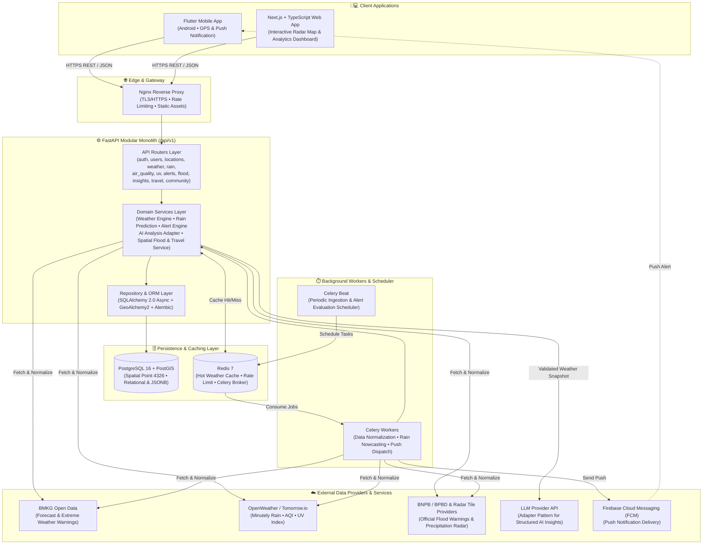
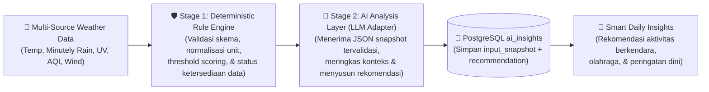
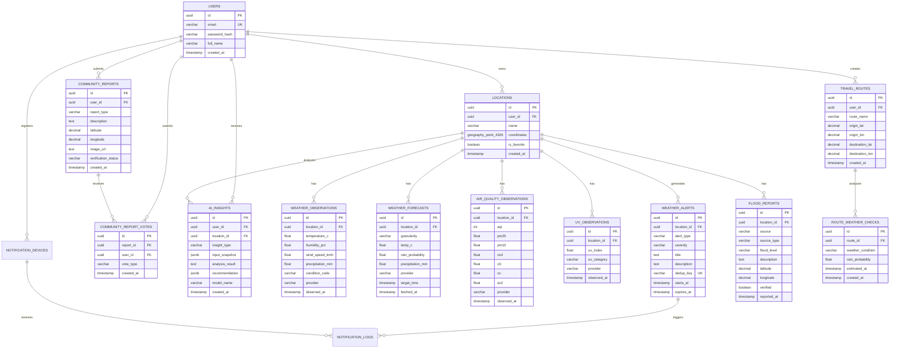
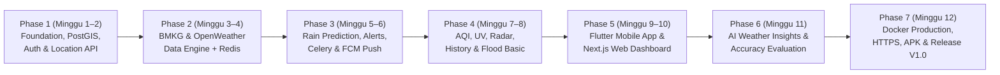

<div align="center">

# 🌦️ WEATHERLY
### **Know the Weather. Prepare Before It Happens.**

**A Full-Stack Weather Intelligence Platform for Hyperlocal Rain Nowcasting, Environmental Monitoring, Proactive Alerts, and AI-Driven Daily Decisions.**

[](https://fastapi.tiangolo.com/)
[](https://nextjs.org/)
[](https://flutter.dev/)
[](https://postgis.net/)
[](https://redis.io/)
[](https://docs.celeryq.dev/)
[](https://www.docker.com/)

[Visi & Latar Belakang](#-kenapa-weatherly-dibuat-why-weatherly) •
[Arsitektur Sistem](#-arsitektur-sistem-system-architecture) •
[8 Modul Utama](#-8-modul-fitur-utama-feature-architecture) •
[Database & ERD](#-desain-database--erd-postgis) •
[API Contract](#-api-contract--endpoints-apiv1) •
[Workflow & CI/CD](#-development-workflow--cicd) •
[Roadmap](#-12-week-engineering-roadmap)

</div>

---

## 💡 Kenapa Weatherly Dibuat? (*Why Weatherly?*)

Aplikasi cuaca konvensional umumnya hanya bersifat **pasif dan deskriptif** — mereka sekadar menjawab pertanyaan:
> *"Bagaimana cuaca hari ini? Berapa derajat suhu sekarang?"*

Di wilayah tropis dengan dinamika mikro-klimatologi yang cepat seperti **Indonesia (khususnya Bandung dan sekitarnya)**, perubahan cuaca terjadi secara mendadak. Hujan deras lokal, petir, angin kencang, lonjakan indeks UV di siang hari, perubahan kualitas udara (AQI/PM2.5), hingga genangan banjir di titik komuter sering kali mengejutkan pengendara motor/mobil, pekerja lapangan, pelajar, dan masyarakat umum.

**Weatherly** dibangun sebagai **Weather Intelligence Platform** yang mengubah paradigma dari *sekadar melihat angka cuaca* menjadi **sistem pendukung keputusan proaktif (*proactive decision-making*)** yang menjawab tiga pertanyaan krusial:
1. **Apa** perubahan cuaca dan risiko lingkungan yang kemungkinan besar terjadi di titik koordinat saya?
2. **Kapan** tepatnya perubahan tersebut tiba (estimasi *lead-time* 10–60 menit ke depan)?
3. **Apa** langkah persiapan atau penyesuaian aktivitas/perjalanan terbaik yang harus saya lakukan sekarang?

### 🎯 Tiga Pilar Utama Weatherly
| Pilar | Pendekatan Konvensional | Pendekatan Weatherly Intelligence |
| :--- | :--- | :--- |
| **1. Prediction Accuracy** | Hanya menampilkan persentase peluang hujan harian tanpa konteks waktu kedatangan. | Menggabungkan multi-provider (*BMKG, OpenWeather One Call, Radar*) dengan evaluasi historis (*false alarm, missed rain event, arrival time accuracy*). |
| **2. Intelligent Recommendation** | Grafik mentah yang harus diinterpretasikan sendiri oleh pengguna. | **Two-Stage AI Pipeline**: Rule Engine memvalidasi threshold cuaca/UV/AQI, lalu LLM merangkum rekomendasi aktivitas yang terverifikasi & bebas halusinasi. |
| **3. Proactive Notification** | Pengguna harus membuka aplikasi untuk mengecek cuaca. | **Celery Alert Engine & FCM** mengirimkan peringatan *sebelum* hujan turun atau cuaca ekstrem melanda lokasi pengguna dengan *deduplication guard*. |

---

## 🏗️ Arsitektur Sistem (*System Architecture*)

Weatherly menggunakan arsitektur **Modular Monolith** di sisi backend yang dikombinasikan dengan **Asynchronous Distributed Task Queue (Celery + Redis)** dan **Spatial Database (PostgreSQL + PostGIS)**. Pendekatan ini dipilih agar memiliki pemisahan domain (*Separation of Concerns*) sekelas enterprise, mudah diuji (*testable*), namun tetap efisien untuk di-deploy dan dipelihara dalam satu **Monorepo**.

### 1. High-Level System Architecture Diagram



### 2. Two-Stage AI Weather Analysis Pipeline (Anti-Hallucination Design)

Weatherly **tidak** menggunakan AI untuk menebak angka prediksi hujan dari nol. Untuk menjamin keandalan ilmiah dan mencegah halusinasi data:



> [!IMPORTANT]
> **Prinsip Keamanan & Integritas Data AI:**
> - AI hanya menerima `input_snapshot` terstruktur yang mencantumkan sumber provider, timestamp UTC, dan status kelengkapan data.
> - Jika parameter (misal polutan `so2` atau radar menit ke-45) bernilai `NULL`, AI wajib menyatakan data tidak tersedia — bukan mengarang angka estimasi.
> - Tidak ada PII (*Personally Identifiable Information*) atau API secret yang pernah dimasukkan ke dalam `input_snapshot`.

---

## 🧩 8 Modul Fitur Utama (*Feature Architecture*)

Weatherly dibangun di atas 8 modul domain yang saling terintegrasi, dibagi ke dalam kategori **Core**, **Intelligence**, dan **Supporting**:

| # | Modul | Kategori | Fase Target | Kapabilitas Utama |
| :-: | :--- | :---: | :---: | :--- |
| **1** | **Rain Intelligence** | `Core` | **MVP (v1.0)** | Prediksi probabilitas hujan 10–60 menit ke depan (*nowcasting*), estimasi waktu kedatangan hujan, intensitas presipitasi (mm/jam), grafik tren, dan notifikasi pra-hujan. |
| **2** | **Extreme Weather** | `Core` | **MVP (v1.0)** | Deteksi & peringatan dini hujan lebat, petir, angin kencang, serta sinkronisasi peringatan cuaca ekstrem resmi dari BMKG. |
| **3** | **Air Quality Monitoring** | `Supporting` | **MVP (v1.0)** | Pemantauan AQI, PM2.5, PM10, NO2, O3, CO, SO2 (kolom tak tersedia disimpan `NULL` secara jujur), histori kualitas udara, dan rekomendasi aktivitas luar ruang. |
| **4** | **UV Monitoring** | `Supporting` | **MVP (v1.0)** | Indeks UV *real-time* & prakiraan jam puncak UV tinggi, klasifikasi kategori risiko, serta panduan perlindungan kulit. |
| **5** | **Flood Monitoring** | `Supporting` | **v1.5** | Peringatan banjir resmi (BNPB/BPBD), peta spasial area terdampak, laporan genangan, dan konteks curah hujan (*membedakan dengan tegas antara risiko curah hujan vs. kejadian banjir terkonfirmasi*). |
| **6** | **AI Weather Insights** | `Intelligence` | **v1.5** | Sistem analisis otomatis berbasis konteks cuaca harian untuk menjawab kelayakan berkendara, waktu terbaik berolahraga, dan alasan ilmiah di balik peringatan hujan. |
| **7** | **Smart Travel** | `Supporting` | **v2.0** | Analisis cuaca berbasis rute perjalanan (titik asal ke tujuan), estimasi probabilitas hujan di sepanjang koridor rute berdasarkan jam keberangkatan. |
| **8** | **Community Reports** | `Supporting` | **v2.0** | Crowdsourcing laporan kondisi lokal (hujan lokal, banjir/genangan, pohon tumbang, angin kencang) lengkap dengan foto, koordinat PostGIS, sistem *up/down vote* (`UNIQUE(report_id, user_id)`), dan moderasi. |

### ✅ Cakupan Wajib MVP (Version 1.0 Checklist)
- [ ] **User Authentication**: Registrasi, login JWT + Refresh Token, password hashing dengan Argon2, dan manajemen profil.
- [ ] **Location Management**: Koordinat GPS *on-open* (tanpa *background tracking* invasif) dan penyimpanan lokasi favorit berbasis PostGIS `geography(Point, 4326)`.
- [ ] **Live Weather Engine**: Normalisasi suhu, kelembapan, kecepatan angin, dan kondisi cuaca aktual dari multi-provider.
- [ ] **Rain Prediction**: Estimasi waktu turun hujan dan probabilitas presipitasi jangka pendek.
- [ ] **Weather Alerts & Push Notification**: Alert Engine bebas duplikasi (*deduplicated*) yang terhubung ke Firebase Cloud Messaging (FCM).
- [ ] **UV & Air Quality**: Integrasi metrik AQI, PM2.5, PM10, dan UV Index.
- [ ] **Cross-Platform Dashboard**: Aplikasi mobile Flutter dan dashboard web Next.js yang responsif.
- [ ] **Weather History**: Penyimpanan dan visualisasi riwayat observasi vs. akurasi prediksi.

---

## 🗄️ Desain Database & ERD (PostgreSQL + PostGIS)

Seluruh tabel menggunakan `UUID` sebagai Primary Key, menyimpan waktu dalam format `UTC`, menggunakan indeks spasial dan temporal pada kolom lokasi serta waktu observasi, dan dikelola melalui **Alembic Migrations**.



---

## 🔌 API Contract & Endpoints (`/api/v1`)

Seluruh endpoint berada di bawah prefix `/api/v1` dan menggunakan autentikasi `Bearer JWT` untuk rute yang mengakses profil, perangkat, atau lokasi tersimpan.

| Domain Modul | Method | Endpoint | Deskripsi |
| :--- | :---: | :--- | :--- |
| **Auth** | `POST` | `/api/v1/auth/register` | Registrasi akun pengguna baru (Argon2 password hashing) |
| **Auth** | `POST` | `/api/v1/auth/login` | Autentikasi pengguna & penerbitan JWT Access + Refresh Token |
| **Auth** | `GET` | `/api/v1/auth/me` | Profil dan preferensi pengguna yang sedang login |
| **Location** | `GET` | `/api/v1/locations` | Daftar lokasi pemantauan & lokasi favorit pengguna |
| **Location** | `POST` | `/api/v1/locations` | Menyimpan lokasi baru (koordinat GPS / nama wilayah) |
| **Location** | `PATCH` | `/api/v1/locations/{id}` | Memperbarui label atau status favorit lokasi |
| **Weather** | `GET` | `/api/v1/weather/current` | Kondisi cuaca aktual yang telah dinormalisasi |
| **Weather** | `GET` | `/api/v1/weather/forecast` | Prakiraan cuaca per jam (*hourly*) dan harian (*daily*) |
| **Weather** | `GET` | `/api/v1/weather/minutely` | Presipitasi per menit (10–60 menit ke depan) |
| **Weather** | `GET` | `/api/v1/weather/radar` | Metadata & layer tile radar presipitasi wilayah Indonesia |
| **Rain** | `GET` | `/api/v1/rain/prediction` | Analisis kedatangan hujan, probabilitas, dan kurva intensitas |
| **Rain** | `GET` | `/api/v1/rain/history` | Histori presipitasi & perbandingan akurasi prediksi vs. observasi |
| **Air Quality** | `GET` | `/api/v1/air-quality/current` | Indeks AQI dan polutan (`pm25`, `pm10`, `no2`, `o3`, `co`, `so2`) |
| **Air Quality** | `GET` | `/api/v1/air-quality/history` | Tren kualitas udara historis pada lokasi pemantauan |
| **UV** | `GET` | `/api/v1/uv/current` | UV Index saat ini beserta kategori risiko dan saran proteksi |
| **UV** | `GET` | `/api/v1/uv/forecast` | Prakiraan jam puncak UV sepanjang hari |
| **Alerts** | `GET` | `/api/v1/alerts` | Daftar peringatan cuaca aktif pada lokasi pengguna |
| **Alerts** | `GET` | `/api/v1/alerts/{id}` | Detail peringatan cuaca ekstrem dan instruksi keselamatan |
| **Flood** | `GET` | `/api/v1/flood/nearby` | Informasi banjir & genangan di sekitar koordinat (`source_type` terklasifikasi) |
| **Flood** | `POST` | `/api/v1/flood/reports` | Mengirim laporan genangan/banjir untuk diverifikasi |
| **AI Insights** | `GET` | `/api/v1/insights/daily` | Ringkasan analisis cuaca harian dan rekomendasi aktivitas |
| **AI Insights** | `POST` | `/api/v1/insights/generate` | Memicu pembuatan analisis AI berbasis snapshot cuaca terbaru |
| **Travel** | `POST` | `/api/v1/travel/routes` | Menyimpan koridor rute perjalanan (asal & tujuan) |
| **Travel** | `GET` | `/api/v1/travel/{id}/weather` | Estimasi cuaca dan risiko hujan sepanjang titik rute perjalanan |
| **Community** | `GET` | `/api/v1/community/reports` | Daftar laporan cuaca lokal dari komunitas sekitar |
| **Community** | `POST` | `/api/v1/community/reports` | Membuat laporan komunitas (hujan lokal, pohon tumbang, angin, banjir) |
| **Community** | `POST` | `/api/v1/community/reports/{id}/vote` | Memberikan *upvote/downvote* verifikasi laporan (`UNIQUE` per user) |
| **Notification** | `POST` | `/api/v1/devices/register` | Mendaftarkan token FCM perangkat untuk push notification |
| **Notification** | `GET` | `/api/v1/notifications` | Riwayat notifikasi peringatan cuaca yang dikirim ke pengguna |

<details>
<summary><b>📄 Contoh Kontrak JSON Response: <code>GET /api/v1/insights/daily</code></b></summary>

```json
{
  "location": "Bandung",
  "summary": "Potensi hujan meningkat pada sore hari.",
  "insights": [
    {
      "type": "rain",
      "severity": "medium",
      "recommendation": "Siapkan payung sebelum bepergian."
    },
    {
      "type": "uv",
      "severity": "high",
      "recommendation": "Gunakan perlindungan dari paparan UV."
    }
  ],
  "generated_at": "2026-11-24T06:00:00Z"
}
```
</details>

---

## 📂 Struktur Monorepo (*Repository Structure*)

```text
weatherly/
├── apps/
│   ├── mobile/                     # Flutter Android Application
│   └── web/                        # Next.js + TypeScript Web Dashboard
│
├── backend/                        # Python FastAPI Modular Monolith
│   ├── app/
│   │   ├── api/
│   │   │   └── v1/                 # HTTP Routers (auth, users, locations, weather, rain,
│   │   │                           # air_quality, uv, alerts, flood, insights, travel, community)
│   │   ├── core/                   # config.py, security.py (JWT/Argon2), database.py
│   │   ├── models/                 # SQLAlchemy + GeoAlchemy2 ORM Models
│   │   ├── schemas/                # Pydantic v2 Request/Response Schemas
│   │   ├── repositories/           # Database Access & Spatial Queries
│   │   ├── services/               # Business Logic (weather, prediction, air_quality,
│   │   │                           # flood, uv, ai, travel, community, notifications)
│   │   ├── workers/                # Celery Tasks & Periodic Schedules
│   │   └── main.py                 # FastAPI Application Entrypoint
│   ├── migrations/                 # Alembic Database Migrations
│   ├── tests/                      # Unit, Integration & Prediction Accuracy Tests
│   ├── requirements.txt
│   └── Dockerfile
│
├── infrastructure/
│   ├── docker/                     # Dockerfiles & Compose overrides
│   ├── nginx/                      # Reverse Proxy & TLS configuration
│   └── monitoring/                 # Healthchecks, logging & metrics configuration
│
├── docs/
│   ├── architecture/               # Dokumentasi Arsitektur Sistem & Data Pipeline
│   ├── product/                    # Blueprint Produk & Spesifikasi Fitur
│   ├── database/                   # Skema ERD, PostGIS & Kebijakan Retensi Data
│   ├── api/                        # Spesifikasi OpenAPI & Kontrak Endpoint
│   └── deployment/                 # Panduan Workflow Git, CI/CD & Produksi
│
├── scripts/                        # Utilitas automasi database, seed & evaluasi prediksi
├── .github/
│   └── workflows/                  # GitHub Actions CI/CD Pipelines (Backend, Web, Mobile, Release)
├── .env.example                    # Template Environment Variables
├── docker-compose.yml              # Local Full-Stack Orchestration (PostGIS, Redis, API, Celery, Web)
└── README.md
```

---

## 🔄 Development Workflow & CI/CD

Weatherly menerapkan disiplin rekayasa perangkat lunak modern melalui **GitFlow yang disederhanakan** dan **GitHub Actions CI/CD Pipelines** otomatis.

### 1. Standar Git Branching
* `main` — Branch produksi (*production-ready*). Setiap push/merge ke `main` memicu pipeline validasi rilis dan build image Docker produksi.
* `develop` — Branch integrasi utama tempat seluruh fitur yang telah lulus CI digabungkan.
* `feature/<nama-fitur>` — Branch pengembangan per fitur (contoh: `feature/weather-api`, `feature/rain-prediction`).
* `fix/<nama-bug>` — Branch perbaikan bug terisolasi (contoh: `fix/notification-duplicate`).

> **Aturan Commit & PR:** Satu fitur dikerjakan, diuji secara lokal, lalu diajukan melalui Pull Request ke `develop`. Hindari menggabungkan banyak modul yang tidak berhubungan dalam satu commit.

### 2. GitHub Actions Workflows (`.github/workflows/`)
Repositori ini dilengkapi dengan 3 workflow otomatis di `.github/workflows/`:
1. **`ci.yml` (Continuous Integration — Monorepo Pipeline)**:
   - **Path Filtering & Smart Change Detection**: Mengecek perubahan di `backend/`, `apps/web/`, dan `apps/mobile/`.
   - **Backend Job**: Menjalankan *linting* (`ruff`), *type checking*, dan pengujian `pytest` dengan service container **PostgreSQL + PostGIS (`postgis/postgis:16-3.4`)** serta **Redis 7**.
   - **Web Job**: Menjalankan instalasi dependensi, `tsc --noEmit` (*TypeScript check*), `eslint`, dan build verifikasi Next.js.
   - **Mobile Job**: Menjalankan `flutter analyze` dan `flutter test` untuk memastikan kualitas aplikasi Android.
2. **`security-and-quality.yml` (Security & Secret Audit)**:
   - Memindai kerentanan dependensi, memeriksa kebocoran *credentials/API keys*, dan memvalidasi konfigurasi Docker.
3. **`cd-release.yml` (Continuous Delivery & Container Build)**:
   - Membangun dan memvalidasi Docker image untuk `backend` (FastAPI + Celery) dan `web` (Next.js), serta menyiapkan *release artifact* saat tag versi (`v*.*.*`) dibuat.

---

## 🚀 Quick Start (Local Development)

### Prasyarat
- **Docker & Docker Compose** (v2.20+)
- **Python 3.11+** (untuk pengembangan lokal `backend/`)
- **Node.js 20+** (untuk pengembangan lokal `apps/web/`)
- **Flutter SDK 3.22+** (untuk pengembangan lokal `apps/mobile/`)

### Menjalankan Seluruh Infrastruktur dengan Docker Compose
```bash
# 1. Clone repository
git clone https://github.com/afriza/weatherly.git
cd weatherly

# 2. Salin template environment variables
cp .env.example .env

# 3. Jalankan PostgreSQL+PostGIS, Redis, FastAPI Backend, Celery Worker/Beat, dan Next.js Web
docker compose up --build -d

# 4. Jalankan migrasi database Alembic
docker compose exec backend alembic upgrade head
```

Layanan akan tersedia pada:
- **FastAPI Backend & Swagger Docs**: `http://localhost:8000/docs`
- **Next.js Web Dashboard**: `http://localhost:3000`
- **PostgreSQL + PostGIS**: `localhost:5432`
- **Redis Broker & Cache**: `localhost:6379`

---

## 🗺️ 12-Week Engineering Roadmap



| Versi Rilis | Fokus Pengembangan |
| :---: | :--- |
| **V1.0 (MVP)** | Live Weather, Rain Prediction (Nowcasting), Weather Alerts + FCM, UV Index, Air Quality (AQI), Mobile & Web Dashboard, Weather History. |
| **V1.5** | Flood Monitoring terintegrasi (BNPB/BPBD + spasial) & AI Weather Insights penuh. |
| **V2.0** | Smart Travel (cuaca sepanjang koridor rute perjalanan) & Community Reports dengan sistem voting/moderasi. |
| **V2.5** | Evaluasi & kalibrasi model prediksi menggunakan dataset observasi historis lokal Bandung. |
| **V3.0** | Personalisasi profil aktivitas pengguna dan ekspansi cakupan wilayah nasional. |

---

## 🔒 Standar Keamanan & Reliabilitas (*Security & Reliability*)

- **Authentication & Password**: JWT (*short-lived access token* + *rotating refresh token*) dan hashing password dengan **Argon2**.
- **Location Privacy**: Tidak melakukan pelacakan lokasi latar belakang tanpa izin eksplisit; MVP menggunakan lokasi saat aplikasi dibuka (*on-open*) atau titik lokasi favorit yang disimpan pengguna.
- **Alert Deduplication**: Setiap peringatan cuaca memiliki kunci deterministik sehingga pengguna tidak pernah menerima spam notifikasi duplikat untuk kejadian cuaca yang sama.
- **Background Job Resilience**: Celery worker dilengkapi mekanisme *exponential backoff retry*, *timeout guard*, dan *graceful degradation* ketika salah satu API cuaca eksternal mengalami gangguan.

---

<div align="center">
  <b>Weatherly Platform</b> — Built as a Production-Grade Full-Stack Weather Intelligence Portfolio.<br/>
  <sub>Initial Region Focus: Bandung & West Java, Indonesia 🇮🇩</sub>
</div>
