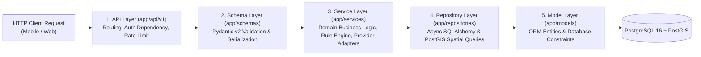
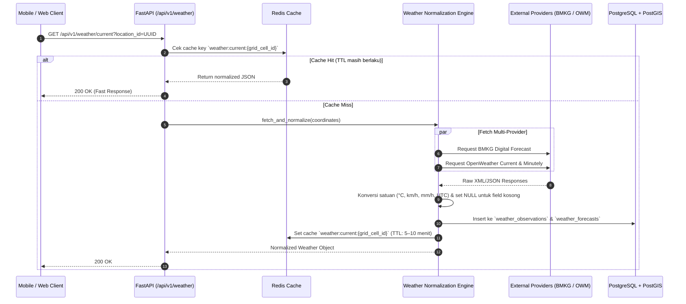
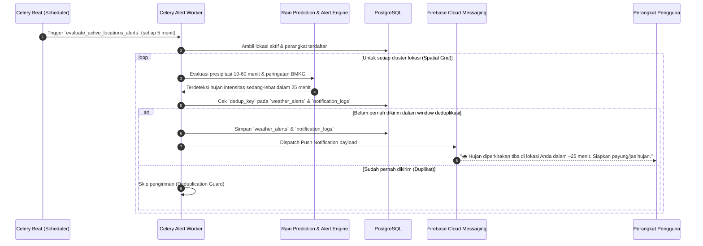

# ☕Arsitektur Sistem Weatherly (System Architecture Specification)

Dokumen ini menjelaskan arsitektur teknis **Weatherly — Weather Intelligence Platform** secara mendalam, mencakup topologi komponen, pembagian *layer* pada backend FastAPI, alur ingesti dan normalisasi data cuaca, *Two-Stage AI Analysis Pipeline*, hingga strategi *alert deduplication* dan *spatial indexing*.

---

## 1. Prinsip Desain Arsitektur

1. **Modular Monolith First**:
   Daripada memecah aplikasi terlalu dini menjadi banyak microservices yang meningkatkan kompleksitas jaringan dan deployment, Weatherly menggunakan **Modular Monolith** dengan batas domain (*domain boundaries*) yang ketat. Setiap domain (`weather`, `prediction`, `air_quality`, `uv`, `flood`, `ai`, `travel`, `community`, `notifications`) memiliki *router*, *schema*, *service*, dan *repository* masing-masing.
2. **Strict Layer Separation**:
   Logika bisnis prediksi hujan atau kalkulasi threshold cuaca ekstrem **tidak boleh** berada di dalam HTTP router (`api/v1/`) maupun di dalam kode klien (`Flutter` / `Next.js`).
3. **Honest Data Representation**:
   - Kolom polutan atau metrik cuaca yang tidak disediakan oleh provider eksternal harus disimpan sebagai `NULL`, bukan diisi angka tebakan/interpolasi palsu.
   - Estimasi curah hujan tinggi **tidak pernah** diklaim sebagai "kejadian banjir terkonfirmasi"; sistem memisahkan `source_type` (`official`, `community`, `estimated_risk`).
4. **Anti-Hallucination AI Layer**:
   LLM tidak menghitung probabilitas hujan. LLM hanya bertindak sebagai *interpreter* dan *recommender* di atas `input_snapshot` JSON yang sudah divalidasi oleh **Rule Engine** deterministik.

---

## 2. Pembagian Layer Backend (`backend/app/`)

| Layer | Direktori | Tanggung Jawab Utama |
| :--- | :--- | :--- |
| **API Layer** | `backend/app/api/v1/` | Menerima request HTTP, memeriksa token autentikasi JWT, memvalidasi parameter query/path, dan mengembalikan HTTP status code yang sesuai. |
| **Schemas Layer** | `backend/app/schemas/` | Kontrak data masuk (*Request DTO*) dan keluar (*Response DTO*) menggunakan Pydantic v2. |
| **Services Layer** | `backend/app/services/` | Otak utama aplikasi: normalisasi multi-provider, algoritma *rain nowcasting*, *Alert Engine*, *LLM Adapter*, dan kalkulasi cuaca rute perjalanan. |
| **Repositories Layer** | `backend/app/repositories/` | Abstraksi query ke PostgreSQL + PostGIS (pencarian radius `ST_DWithin`, upsert observasi, deduplikasi alert). |
| **Models Layer** | `backend/app/models/` | Definisi tabel database menggunakan SQLAlchemy 2.0 dan GeoAlchemy2 (`geography(Point, 4326)`). |
| **Workers Layer** | `backend/app/workers/` | Task asynchronous Celery untuk penarikan data berkala, evaluasi alert latar belakang, dan pengiriman notifikasi ke FCM. |
| **Core Layer** | `backend/app/core/` | Konfigurasi environment (`config.py`), keamanan JWT & Argon2 (`security.py`), serta koneksi pool database & Redis (`database.py`). |

---

## 3. Alur Data & Pipeline Utama

### A. Weather Ingestion, Normalization & Caching Flow

Karena Weatherly menggunakan strategi **Multi-Provider** (BMKG untuk prakiraan resmi & peringatan ekstrem Indonesia, OpenWeather/Tomorrow.io untuk presipitasi menit, AQI, dan UV), seluruh data mentah harus melewati **Weather Normalization Engine**:

### B. Proactive Rain & Extreme Weather Alert Pipeline (Celery + FCM)

Nilai utama Weatherly adalah memberi tahu pengguna **sebelum** hujan turun atau cuaca ekstrem tiba, tanpa mengirim notifikasi berulang (*duplicate spam*):

---

## 4. Strategi Evaluasi Akurasi Prediksi (*Prediction Verification*)

Agar Weatherly memiliki standar ilmiah yang kuat di dalam portofolio, sistem menyimpan tabel `weather_forecasts` (apa yang diprediksi pada waktu $t_0$ untuk target waktu $t_1$) dan `weather_observations` (apa yang benar-benar terjadi pada waktu $t_1$).

Dari kedua tabel tersebut, modul `Analytics` dapat menghitung metrik evaluasi objektif:
1. **Hit Rate (Probability of Detection / POD)**: Persentase kejadian hujan aktual yang berhasil diprediksi sebelumnya oleh Weatherly.
2. **False Alarm Ratio (FAR)**: Persentase peringatan hujan yang dikirim tetapi hujan tidak jadi turun pada jam tersebut.
3. **Arrival Time Error (MAE dalam menit)**: Selisih rata-rata antara estimasi waktu kedatangan hujan (misal diprediksi pukul 15:20) dengan waktu observasi hujan pertama kali tercatat (misal turun pukul 15:30 $\rightarrow$ error 10 menit).
