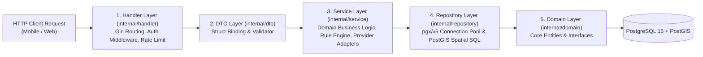
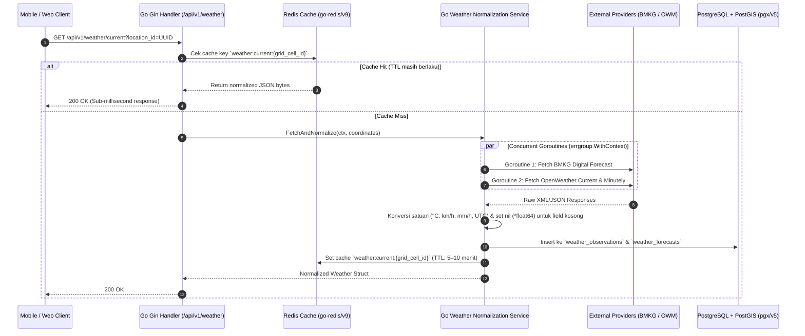
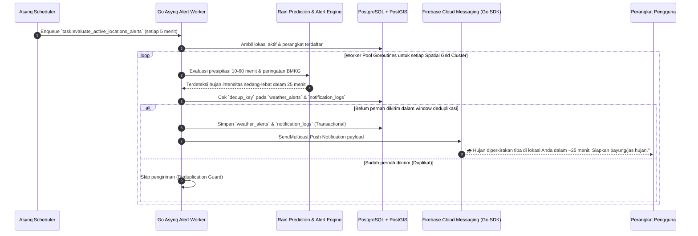

# 🏗️ Arsitektur Sistem Weatherly (Golang System Architecture Specification)

Dokumen ini menjelaskan arsitektur teknis **Weatherly — Weather Intelligence Platform** berbasis **Golang (Go 1.23+)** secara mendalam, mencakup topologi komponen, pembagian *Clean Architecture layer* pada backend Go, alur ingesti dan normalisasi data cuaca konkuren (`goroutines` & `errgroup`), *Two-Stage AI Analysis Pipeline*, hingga strategi *alert deduplication* (`Asynq` + Redis) dan *spatial indexing* (PostGIS).

---

## 1. Prinsip Desain Arsitektur

1. **Golang Modular Monolith (Clean Architecture)**:
   Daripada memecah aplikasi terlalu dini menjadi banyak microservices yang meningkatkan kompleksitas jaringan dan deployment, Weatherly menggunakan **Golang Modular Monolith** dengan batas domain (*domain boundaries*) yang ketat. Setiap domain (`weather`, `prediction`, `air_quality`, `uv`, `flood`, `ai`, `travel`, `community`, `notifications`) memiliki *handler*, *DTO*, *service*, dan *repository* masing-masing, serta dikompilasi menjadi *single static binary* yang sangat cepat dan hemat memori.
2. **Strict Layer Separation**:
   Logika bisnis prediksi hujan atau kalkulasi threshold cuaca ekstrem **tidak boleh** berada di dalam HTTP handler (`internal/handler/`) maupun di dalam kode klien (`Flutter` / `Next.js`).
3. **Honest Data Representation & Strict Null-Safety**:
   - Kolom polutan atau metrik cuaca yang tidak disediakan oleh provider eksternal direpresentasikan menggunakan pointer Go (`*float64`) dan disimpan sebagai `NULL` di PostgreSQL, bukan diisi angka tebakan/interpolasi palsu (`0.0`).
   - Estimasi curah hujan tinggi **tidak pernah** diklaim sebagai "kejadian banjir terkonfirmasi"; sistem memisahkan `source_type` (`official`, `community`, `estimated_risk`).
4. **Anti-Hallucination AI Layer**:
   LLM tidak menghitung probabilitas hujan. LLM hanya bertindak sebagai *interpreter* dan *recommender* di atas `input_snapshot` JSON yang sudah divalidasi oleh **Go Deterministic Rule Engine**.

---

## 2. Pembagian Layer Backend Golang (`backend/`)

| Layer | Direktori | Tanggung Jawab Utama |
| :--- | :--- | :--- |
| **Entrypoints** | `backend/cmd/api/` & `backend/cmd/worker/` | Titik masuk utama untuk HTTP REST Server (`api`) dan Background Task Processor (`worker`). |
| **Handler Layer** | `backend/internal/handler/` | Menerima request HTTP (`/api/v1`), memeriksa konteks autentikasi JWT, memvalidasi parameter query/path, dan mengembalikan JSON standar. |
| **DTO Layer** | `backend/internal/dto/` | Kontrak data masuk (*Request struct*) dan keluar (*Response struct*) menggunakan tag `json` dan `binding`/`validator`. |
| **Service Layer** | `backend/internal/service/` | Otak utama aplikasi: normalisasi multi-provider paralel dengan `errgroup`, algoritma *rain nowcasting*, *Alert Engine*, *LLM Adapter*, dan kalkulasi cuaca rute perjalanan. |
| **Provider Layer** | `backend/internal/provider/` | HTTP client terisolasi dengan `context.WithTimeout` untuk BMKG, OpenWeather, BNPB, LLM Provider, dan Firebase Cloud Messaging (FCM). |
| **Repository Layer** | `backend/internal/repository/` | Abstraksi query ke PostgreSQL + PostGIS menggunakan `jackc/pgx/v5` (pencarian radius `ST_DWithin`, upsert observasi, deduplikasi alert). |
| **Worker Layer** | `backend/internal/worker/` | Task asynchronous berbasis **Asynq (Redis)** untuk penarikan data berkala, evaluasi alert latar belakang, dan pengiriman notifikasi ke FCM. |

---

## 3. Alur Data & Pipeline Utama

### A. Concurrent Weather Ingestion, Normalization & Caching Flow (`errgroup`)

Karena Weatherly menggunakan strategi **Multi-Provider** (BMKG untuk prakiraan resmi & peringatan ekstrem Indonesia, OpenWeather/Tomorrow.io untuk presipitasi menit, AQI, dan UV), Go memanggil seluruh provider secara paralel menggunakan `golang.org/x/sync/errgroup` untuk menekan latensi:

### B. Proactive Rain & Extreme Weather Alert Pipeline (Go Asynq + FCM)

Nilai utama Weatherly adalah memberi tahu pengguna **sebelum** hujan turun atau cuaca ekstrem tiba, tanpa mengirim notifikasi berulang (*duplicate spam*):

---

## 4. Strategi Evaluasi Akurasi Prediksi (*Prediction Verification*)

Agar Weatherly memiliki standar ilmiah yang kuat di dalam portofolio, sistem menyimpan tabel `weather_forecasts` (apa yang diprediksi pada waktu $t_0$ untuk target waktu $t_1$) dan `weather_observations` (apa yang benar-benar terjadi pada waktu $t_1$).

Dari kedua tabel tersebut, modul `Analytics` dapat menghitung metrik evaluasi objektif:
1. **Hit Rate (Probability of Detection / POD)**: Persentase kejadian hujan aktual yang berhasil diprediksi sebelumnya oleh Weatherly.
2. **False Alarm Ratio (FAR)**: Persentase peringatan hujan yang dikirim tetapi hujan tidak jadi turun pada jam tersebut.
3. **Arrival Time Error (MAE dalam menit)**: Selisih rata-rata antara estimasi waktu kedatangan hujan (misal diprediksi pukul 15:20) dengan waktu observasi hujan pertama kali tercatat (misal turun pukul 15:30 $\rightarrow$ error 10 menit).
