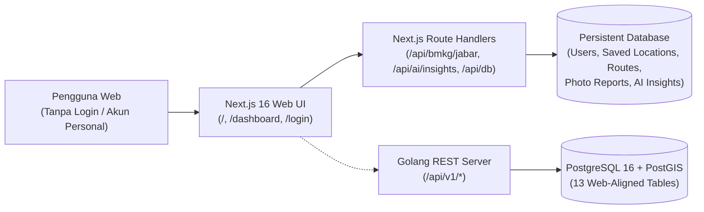

# Arsitektur Sistem Weatherly (Web Platform & Golang Backend Specification)

Dokumen ini menjelaskan arsitektur teknis **Weatherly — Web Weather Intelligence Platform** untuk wilayah **Provinsi Jawa Barat (BMKG Kode 32: 27 Kota/Kabupaten & 627 Kecamatan)** yang dibangun di atas **Next.js 16 + TypeScript (`apps/web`)** dan **Golang Modular Monolith (`backend/`)**.

---

## 1. Prinsip Desain Arsitektur

1. **Web-First Weather Intelligence (Tanpa Ketergantungan Aplikasi Mobile)**:
   Weatherly dirancang khusus sebagai aplikasi web responsif. Peringatan cuaca bekerja secara langsung melalui **Web Real-Time Saved-Location Alert** di Dasbor untuk setiap Kota/Kabupaten atau Kecamatan yang disimpan pengguna, tanpa memerlukan layanan push mobile eksternal (FCM) ataupun tabel perangkat mobile.
2. **Cakupan Penuh BMKG Jawa Barat (Kode 32) & Telemetri Real-Time**:
   Menggabungkan prakiraan cuaca harian resmi dari `bmkg.go.id/cuaca/prakiraan-cuaca/32` (27 Kota/Kabupaten) dan `/32.xx` (627 Kecamatan) dengan observasi suhu aktual, indeks UV, serta polutan kualitas udara (`AQI`, `PM2.5`, `PM10`, `NO2`, `O3`, `CO`, `SO2`) dari API Open-Meteo.
3. **Zero Dummy Data & Bukti Visual Wajib**:
   - Form login dan registrasi tidak menyimpan data akun bawaan.
   - Rute perjalanan **Smart Travel** dimulai kosong sampai pengguna membuat rutenya sendiri.
   - **Laporan Warga (Community Reports)** wajib menyertakan unggahan foto bukti lapangan (`data:image/...`) serta mencatat tanggal, bulan, dan tahun laporan secara lengkap.
4. **Two-Stage Weather-Only AI Engine**:
   - **Tahap 1 (Guardrail & Validasi Data)**: Menolak pertanyaan di luar topik cuaca/lingkungan (seperti politik, tokoh publik, atau topik umum lainnya) dan menyiapkan konteks observasi cuaca saat ini serta prakiraan harian BMKG (`Hari Ini` & `Besok`).
   - **Tahap 2 (Google Gemini 2.5 Flash)**: Menyusun jawaban bahasa Indonesia yang menjelaskan **kondisi cuaca saat ini terlebih dahulu**, diikuti **prediksi harian BMKG** dan saran aktivitas luar ruang.

---

## 2. Topologi Layanan Aplikasi Web (`apps/web`) & Backend (`backend/`)

| Komponen | Lokasi | Tanggung Jawab Utama |
| :--- | :--- | :--- |
| **Landing Page (`/`)** | `apps/web/src/app/page.tsx` | Halaman utama dengan jadwal *Master–Detail* 27 Kota/Kabupaten & 627 Kecamatan, Berita Acara Jawa Barat, Grafik Prakiraan Harian 6 Hari BMKG, Kualitas Udara & UV, serta Tanya AI. |
| **Web Dashboard (`/dashboard`)** | `apps/web/src/app/dashboard/page.tsx` | Panel peringatan cuaca real-time untuk lokasi tersimpan, radar tanda hujan Jawa Barat, pembuatan rute Smart Travel, dan pengiriman laporan warga berfoto. |
| **Auth Page (`/login`)** | `apps/web/src/app/login/page.tsx` | Halaman Masuk dan Daftar Akun Baru yang bersih tanpa kredensial tersimpan. |
| **BMKG & Open-Meteo Engine** | `apps/web/src/app/api/bmkg/jabar/route.ts` | Sinkronisasi live prakiraan harian BMKG Provinsi 32, daftar Kecamatan `32.xx`, RSS Berita Acara Jawa Barat, serta suhu, AQI, dan UV real-time Open-Meteo. |
| **AI Insights Engine** | `apps/web/src/app/api/ai/insights/route.ts` | Validasi topik khusus cuaca dan integrasi Google Gemini 2.5 Flash. |
| **Persistent Database API** | `apps/web/src/app/api/db/route.ts` | Penyimpanan akun pengguna, lokasi alert tersimpan, rute Smart Travel, laporan warga berfoto + tanggal laporan, dan histori AI. |
| **Golang Backend (`/api/v1`)** | `backend/` | Layanan REST modular Go 1.23+ dan skema migrasi SQL PostGIS (13 tabel inti tanpa tabel perangkat mobile). |
