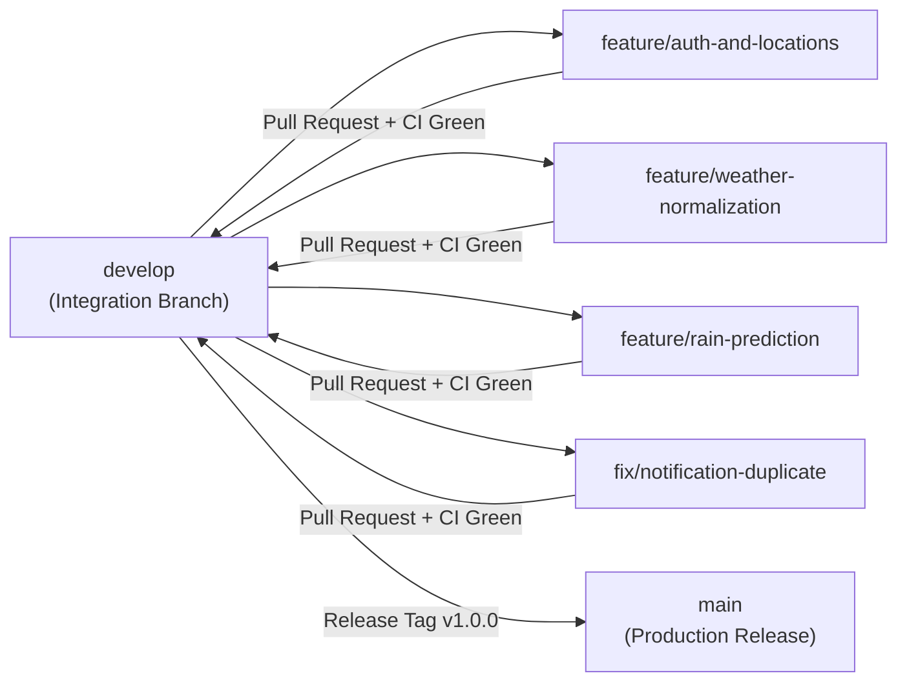

# 🔄 Panduan Engineering Workflow & Standar Pengembangan Weatherly

Dokumen ini mendefinisikan alur kerja (*workflow*) pengembangan untuk monorepo **Weatherly**, mulai dari konfigurasi keputusan teknis, strategi Git branching, konvensi commit, hingga tahapan eksekusi per fitur.

---

## 1. Keputusan Konfigurasi Pengembangan (*Development Configuration*)

Berdasarkan blueprint final Weatherly, konfigurasi pengembangan yang ditetapkan adalah:

| Aspek | Keputusan yang Digunakan | Alasan Teknis |
| :--- | :--- | :--- |
| **1. Struktur Repository** | **Monorepo** (`apps/mobile`, `apps/web`, `backend`, `infrastructure`, `docs`) | Memudahkan sinkronisasi kontrak API antara FastAPI, Next.js, dan Flutter dalam satu PR serta menyederhanakan CI/CD. |
| **2. Database** | **PostgreSQL 16 + PostGIS** | Mendukung tipe data spasial `geography(Point, 4326)` untuk query radius banjir (`ST_DWithin`), laporan komunitas terdekat, dan koridor rute perjalanan. |
| **3. Proses Desain & UI** | **Component-Driven UI selaras dengan kontrak API** | Membangun komponen dashboard modular (Current Weather, Rain Timeline, Radar Map, AQI/UV Card, AI Insights) secara bertahap mengikuti kesiapan endpoint backend. |
| **4. Cara Pengerjaan** | **Iteratif Bertahap (Satu Fitur Selesai & Dites Sebelum Lanjut)** | Mencegah *half-baked features*. Setiap fitur diselesaikan dari migrasi DB $\rightarrow$ Repository $\rightarrow$ Service $\rightarrow$ API Endpoint $\rightarrow$ Automated Test sebelum lanjut ke fitur berikutnya. |

---

## 2. Alur Kerja Git (*Git Branching & PR Workflow*)

### Aturan Branching
1. **`main`**: Branch produksi yang selalu stabil dan siap di-deploy.
2. **`develop`**: Branch integrasi tempat fitur-fitur yang sudah lulus pengujian digabungkan.
3. **`feature/<nama-modul>`**: Branch untuk membuat fitur baru. Contoh:
   - `feature/db-postgis-migrations`
   - `feature/auth-jwt-argon2`
   - `feature/weather-provider-bmkg`
   - `feature/rain-prediction-engine`
   - `feature/alert-fcm-deduplication`
4. **`fix/<nama-masalah>`**: Branch untuk perbaikan bug. Contoh:
   - `fix/notification-duplicate`
   - `fix/null-pollutant-serialization`

### Konvensi Pesan Commit (*Conventional Commits*)
Gunakan format commit yang bersih dan deskriptif:
- `feat(rain): add 60-minute precipitation arrival time estimator`
- `feat(db): create initial postgis migration for core and environmental tables`
- `fix(alerts): prevent duplicate fcm push within 45-minute cooldown window`
- `docs(architecture): add two-stage ai pipeline and postgis erd diagrams`
- `ci(github): configure postgis and redis service containers for pytest`

---

## 3. Siklus Hidup Pengerjaan Satu Fitur (*Feature Definition of Done*)

Setiap kali mengerjakan satu modul di Weatherly, ikuti 6 langkah standar berikut:

1. **Database & Migration (`backend/app/models/` & `backend/migrations/`)**
   - Definisikan model SQLAlchemy/GeoAlchemy2 dengan `UUID`, timestamp `UTC`, dan constraint yang tepat.
   - Buat dan uji migrasi Alembic (`alembic revision --autogenerate` & `alembic upgrade head`).
2. **Repository & Spatial Query (`backend/app/repositories/`)**
   - Tulis fungsi query database yang terisolasi dari HTTP layer.
3. **Service & Business Logic (`backend/app/services/`)**
   - Implementasikan normalisasi data, validasi threshold, atau adapter provider eksternal.
   - Pastikan nilai yang tidak tersedia dari provider tetap `NULL`.
4. **Schema & API Endpoint (`backend/app/schemas/` & `backend/app/api/v1/`)**
   - Buat kontrak request/response Pydantic v2 dan ekspos endpoint di bawah `/api/v1/...`.
5. **Automated Testing (`backend/tests/`)**
   - Tambahkan unit test untuk logika bisnis dan integration test untuk endpoint API.
6. **Client Integration (`apps/web/` & `apps/mobile/`)**
   - Hubungkan endpoint yang sudah teruji ke komponen UI Next.js dan Flutter.
