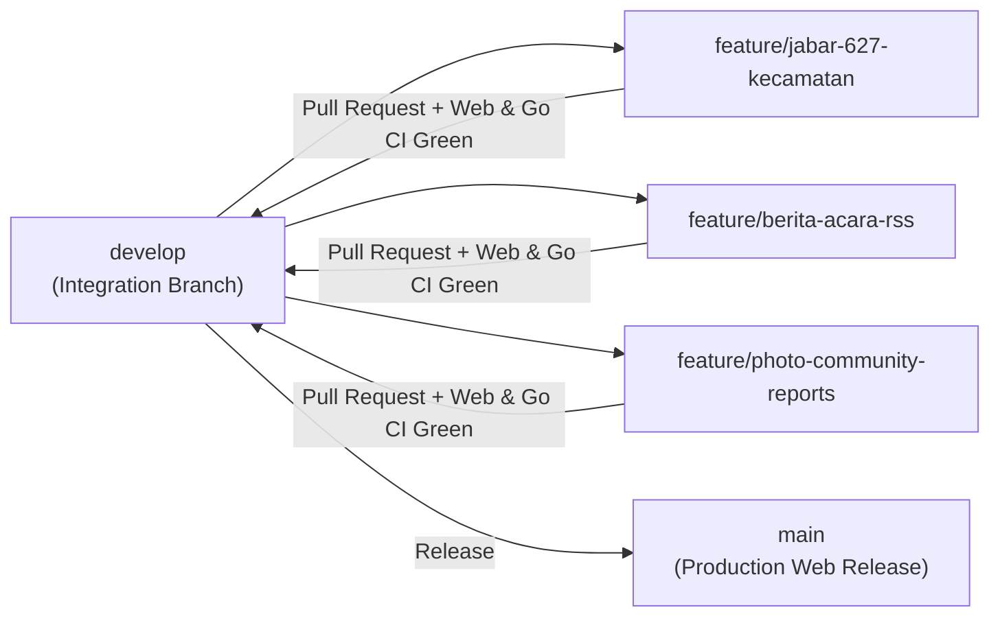

# Panduan Engineering Workflow & Standar Pengembangan Weatherly (Web Platform Edition)

Dokumen ini mendefinisikan alur kerja (*workflow*) pengembangan untuk repositori **Weatherly**, mencakup konfigurasi aplikasi web Next.js + Golang, standar Git branching, hingga verifikasi kualitas kode.

---

## 1. Keputusan Konfigurasi Pengembangan (*Development Configuration*)

| Aspek | Keputusan yang Digunakan | Alasan Teknis |
| :--- | :--- | :--- |
| **1. Fokus Platform** | **Web Application Only (`apps/web` + `backend`)** | Seluruh fitur (27 Kota/Kab & 627 Kecamatan Jawa Barat, Berita Acara, Alert Lokasi Tersimpan, Smart Travel, Laporan Warga Berfoto, dan Tanya AI) diakses langsung melalui browser tanpa ketergantungan aplikasi mobile. |
| **2. Frontend Stack** | **Next.js 16 (App Router) + TypeScript** | Menyediakan tampilan *Synoptic Meteorological Folio* yang cepat, responsif, dan terintegrasi langsung dengan API Route Handlers (`/api/bmkg/jabar`, `/api/ai/insights`, `/api/db`). |
| **3. Backend & Database** | **Persistent Web DB + Golang 1.23 & PostgreSQL/PostGIS** | Menyimpan data pengguna terdaftar, lokasi peringatan cuaca, rute perjalanan buatan pengguna, dan laporan komunitas berfoto secara persisten بدون data dummy. |
| **4. Integritas Data** | **100% Data Valid & Prakiraan Harian BMKG** | Semua prakiraan cuaca berbasis hari (`Hari Ini`, `Besok`, `6 Hari ke Depan`) dari BMKG Jawa Barat (Kode 32), dan kualitas udara/UV diambil secara real-time dari Open-Meteo. |

---

## 2. Alur Kerja Git (*Git Branching & PR Workflow*)

### Standar Verifikasi Sebelum Commit & Push
1. **Web TypeScript & Linting (`apps/web/`)**:
   - Jalankan `npm run lint` dan `npx tsc --noEmit` untuk memastikan tidak ada error TypeScript maupun pelanggaran aturan React Hooks.
2. **Golang Backend Tests (`backend/`)**:
   - Jalankan `go test -v -race ./...` untuk memvalidasi seluruh handler `/api/v1` dan deduplikasi peringatan cuaca web.
3. **Keamanan Kredensial (`.gitignore`)**:
   - File `.env`, `.env.local` (seperti `GEMINI_API_KEY`), serta file runtime lokal (`apps/web/data/`) tidak boleh pernah di-commit ke GitHub.
