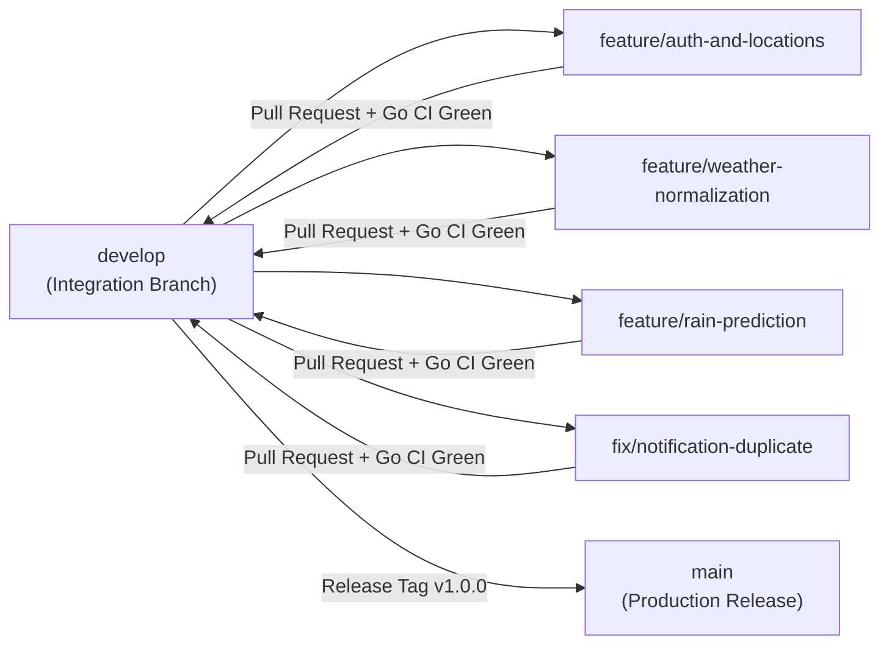

# 🔄 Panduan Engineering Workflow & Standar Pengembangan Weatherly (Golang Edition)

Dokumen ini mendefinisikan alur kerja (*workflow*) pengembangan untuk monorepo **Weatherly**, mulai dari konfigurasi keputusan teknis berbasis **Golang**, strategi Git branching, konvensi commit, hingga tahapan eksekusi per fitur.

---

## 1. Keputusan Konfigurasi Pengembangan (*Development Configuration*)

Berdasarkan blueprint final Weatherly, konfigurasi pengembangan yang ditetapkan adalah:

| Aspek | Keputusan yang Digunakan | Alasan Teknis |
| :--- | :--- | :--- |
| **1. Struktur Repository** | **Monorepo** (`apps/mobile`, `apps/web`, `backend`, `infrastructure`, `docs`) | Memudahkan sinkronisasi kontrak API antara backend Golang, Next.js, dan Flutter dalam satu PR serta menyederhanakan CI/CD. |
| **2. Backend Stack** | **Golang 1.23+ (Gin + pgx/v5 + Asynq + golang-migrate)** | Konkurensi tinggi (`goroutines`) untuk multi-provider weather ingestion, *compile-time type safety* untuk *null handling*, serta binary Docker yang sangat ringan (~20 MB). |
| **3. Database** | **PostgreSQL 16 + PostGIS** | Mendukung tipe data spasial `geography(Point, 4326)` untuk query radius banjir (`ST_DWithin`), laporan komunitas terdekat, dan koridor rute perjalanan. |
| **4. Cara Pengerjaan** | **Iteratif Bertahap (Satu Fitur Selesai & Dites Sebelum Lanjut)** | Mencegah *half-baked features*. Setiap fitur diselesaikan dari migrasi SQL $\rightarrow$ Repository $\rightarrow$ Service $\rightarrow$ Gin Handler $\rightarrow$ Go Test (`-race`) sebelum lanjut ke fitur berikutnya. |

---

## 2. Alur Kerja Git (*Git Branching & PR Workflow*)

### Aturan Branching
1. **`main`**: Branch produksi yang selalu stabil dan siap di-deploy.
2. **`develop`**: Branch integrasi tempat fitur-fitur yang sudah lulus pengujian digabungkan.
3. **`feature/<nama-modul>`**: Branch untuk membuat fitur baru. Contoh:
   - `feature/db-postgis-migrations`
   - `feature/auth-jwt-argon2`
   - `feature/weather-provider-bmkg`
   - `feature/rain-prediction-engine`
   - `feature/alert-fcm-deduplication`
4. **`fix/<nama-masalah>`**: Branch untuk perbaikan bug. Contoh:
   - `fix/notification-duplicate`
   - `fix/null-pollutant-serialization`

### Konvensi Pesan Commit (*Conventional Commits*)
Gunakan format commit yang bersih dan deskriptif:
- `feat(rain): add 60-minute precipitation arrival time estimator in go`
- `feat(db): create initial postgis sql migration for core and environmental tables`
- `fix(alerts): prevent duplicate fcm push within 45-minute cooldown window`
- `docs(architecture): update backend specification to golang clean architecture`
- `ci(github): configure go 1.23, golangci-lint, postgis and redis service containers`

---

## 3. Siklus Hidup Pengerjaan Satu Fitur (*Feature Definition of Done*)

Setiap kali mengerjakan satu modul di Weatherly, ikuti 6 langkah standar berikut:

1. **Database & SQL Migration (`backend/migrations/` & `backend/internal/domain/`)**
   - Buat file migrasi SQL `XXXXXX_<feature>.up.sql` dan `.down.sql` dengan `UUID`, timestamp `UTC`, dan indeks spasial PostGIS.
   - Definisikan entity struct di `internal/domain/` (gunakan pointer `*float64` untuk metrik opsional yang bisa `NULL`).
2. **Repository & Spatial Query (`backend/internal/repository/`)**
   - Tulis query SQL menggunakan `pgx/v5` yang terisolasi dari HTTP layer.
3. **Service & Business Logic (`backend/internal/service/` & `backend/internal/provider/`)**
   - Implementasikan normalisasi data konkuren (`errgroup`), validasi threshold, atau adapter provider eksternal.
4. **DTO & HTTP Handler (`backend/internal/dto/` & `backend/internal/handler/`)**
   - Buat struct request/response DTO dengan validasi dan ekspos endpoint Gin di bawah `/api/v1/...`.
5. **Automated Testing (`backend/internal/.../*_test.go`)**
   - Tambahkan unit test dan integration test, lalu jalankan `go test -v -race ./...`.
6. **Client Integration (`apps/web/` & `apps/mobile/`)**
   - Hubungkan endpoint yang sudah teruji ke komponen UI Next.js dan Flutter.
